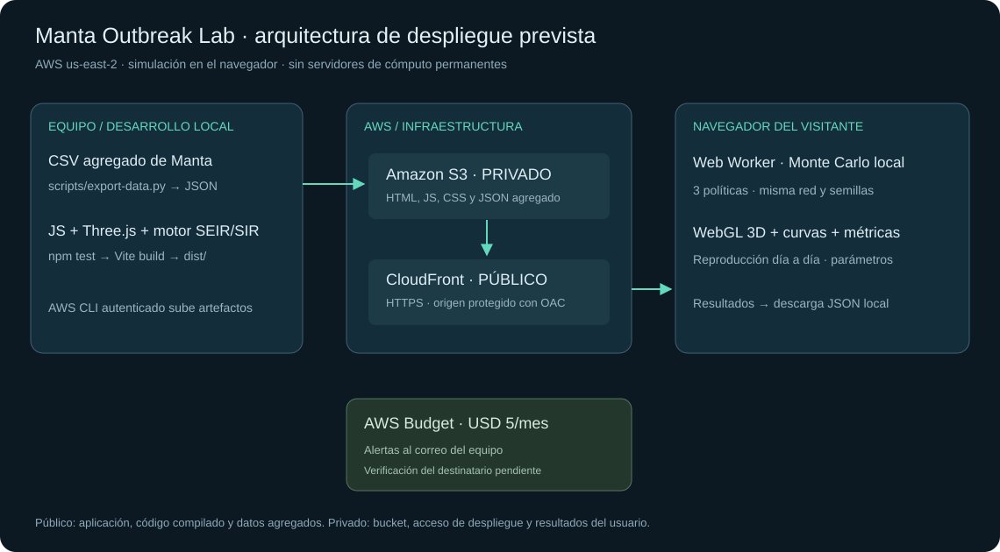
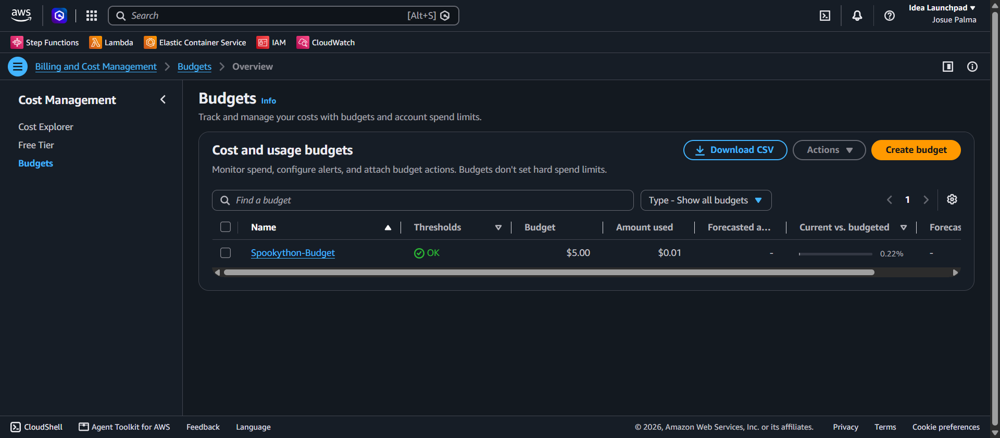

# Simulador de Contención Epidémica de Manta (Proyecto Weezing)

**Spookython · Track B: Modelos y Algoritmos de Contención**  
Herramienta de simulación computacional que modela la propagación de un patógeno respiratorio agudo en una red de contactos sintética de siete sectores urbanos de Manta (Ecuador). El sistema optimiza la asignación de recursos limitados mediante un protocolo territorial en cascada y demuestra cuantitativamente el beneficio frente a actuar al azar o no intervenir.

> **Aviso de alcance:** Simulación computacional académica desarrollada exclusivamente para el hackathon Spookython. Los parámetros son ilustrativos y no constituyen predicción epidemiológica ni recomendación sanitaria clínica oficial.

---

## Resumen del Escenario Epidemiológico

- **El patógeno:** Transmisión aérea por microgotas/aerosoles en contactos cercanos. Dinámica temporal gobernada por un autómata celular estocástico de estados discretos **SEIR** ($S \to E \to I \to R$), con periodo de latencia/incubación medio de 5 días ($\sigma = 0.2$), periodo infeccioso de 10 días ($\gamma = 0.1$) y tasa de transmisión basal $\beta = 0.03$. Número reproductivo básico de referencia: $R_0 = \frac{\beta \cdot \langle k \rangle}{\gamma} \approx 2.4$.
- **La población:** Red de contactos sintética de $N = 1000$ habitantes estructurada en 7 sectores de Manta (*Tarqui, Los Esteros, Manta Centro, Eloy Alfaro, San Mateo, Barbasquillo y San Lorenzo*). El grafo garantiza adyacencias libres de colisiones visuales mediante dispersión radial por filotaxis áurea e interconexión mediante 4 puentes intersectoriales clave y hubs de alta densidad.
- **La intervención:** Vacunación focalizada con vacuna imperfecta tipo *leaky* (eficacia $\eta = 0.8$, reduciendo la probabilidad de contagio en un 80%), soporte de brigadistas comunitarios voluntarios ($v = 0.12$) y stock restringido al 40% de la población ($K = 400$ dosis).
- **Regla estricta de elegibilidad:** El algoritmo solo vacuna a individuos en estado Susceptible ($S$). Nunca se desperdician dosis en personas ya infectadas ($E, I$) o recuperadas/inmunes ($R$).

---

## 1. Puesta en Marcha Rápida (Cómo encender el simulador)

Para poder visualizar el simulador en el navegador (`http://localhost:8000`) o consumir su API, primero debemos iniciar el servidor backend. Elige la opción adecuada para tu entorno:

### Opción A (Recomendada): Vía Docker
*(No requiere configurar Python ni entornos locales; solo requiere tener Docker en ejecución)*

```bash
# 1. Construir la imagen del contenedor
docker build -f infra/Dockerfile -t manta-sim .

# 2. Iniciar el contenedor escuchando en el puerto 8000
docker run --rm -p 8000:8000 manta-sim
```

---

### Opción B: Vía Python en Linux / macOS
*(Requiere Python 3.12)*

```bash
# 1. Crear y activar el entorno virtual
python3 -m venv .venv
source .venv/bin/activate

# 2. Instalar dependencias del proyecto y pruebas
python -m pip install -r requirements.txt
python -m pip install -e ".[test]"

# 3. Iniciar el servidor FastAPI con Uvicorn
python3 -m uvicorn seir.app:app --app-dir src --host 127.0.0.1 --port 8000 --reload
```

---

### Opción C: Vía Python en Windows (PowerShell)
*(Requiere Python 3.12)*

```powershell
# 1. Crear y activar el entorno virtual
python -m venv .venv
.venv\Scripts\Activate.ps1

# 2. Instalar dependencias del proyecto y pruebas
python -m pip install -r requirements.txt
python -m pip install -e ".[test]"

# 3. Iniciar el servidor FastAPI con Uvicorn
python3 -m uvicorn seir.app:app --app-dir src --host 127.0.0.1 --port 8000 --reload
```

---

### Opción D: Alternativa con Conda / Mamba
*(Si utilizas Anaconda o Miniconda)*

```bash
# 1. Crear y activar entorno Conda con Python 3.12
conda create -n manta python=3.12 -y
conda activate manta

# 2. Instalar dependencias del proyecto y pruebas
python -m pip install -r requirements.txt
python -m pip install -e ".[test]"

# 3. Iniciar el servidor
python3 -m uvicorn seir.app:app --app-dir src --host 127.0.0.1 --port 8000 --reload
```

> **Servicio activo:** Cuando la terminal indique `Uvicorn running on http://0.0.0.0:8000`, el servidor estará listo. Mantén esa terminal abierta y continúa con el paso 2.

---

## 2. Reproducción para el Jurado (Track B)

Con el servidor encendido en el paso anterior, el jurado puede validar inmediatamente la configuración oficial congelada en [`configs/default_params.json`](configs/default_params.json) (*Semilla 42, N=1000, 60 días, Stock 400, Tarqui como foco inicial*):

### Vía Visual (Recomendada)
Abre en tu navegador:  
👉 **`http://localhost:8000`**

La interfaz carga automáticamente la simulación oficial, animando la propagación en el mapa interactivo de Manta, graficando las curvas epidemiológicas y desplegando el balance final comparativo.

### Vía Terminal / API (Auditoría Técnica sin navegador)
*(Ejecutar en una segunda ventana de terminal mientras el servidor del Paso 1 continúa corriendo)*

**En Linux / macOS (cURL):**
```bash
# 1. Comprobar que el servicio responde
curl -s http://localhost:8000/health

# 2. Obtener el resumen numérico exacto de la simulación oficial
curl -s -X POST http://localhost:8000/api/simulate \
  -H "Content-Type: application/json" \
  -d @configs/default_params.json | jq '{propuesta: .strategies.proposed.metrics, azar: .strategies.random.metrics, control: .strategies.none.metrics}'
```

**En Windows (PowerShell):**
```powershell
# 1. Comprobar que el servicio responde
Invoke-RestMethod http://localhost:8000/health

# 2. Obtener el resumen numérico exacto de la simulación oficial
$body = Get-Content configs/default_params.json -Raw
$res = Invoke-RestMethod http://localhost:8000/api/simulate -Method Post -ContentType application/json -Body $body
[PSCustomObject]@{
    Propuesta = $res.strategies.proposed.metrics
    Azar      = $res.strategies.random.metrics
    Control   = $res.strategies.none.metrics
} | ConvertTo-Json -Depth 3
```

### Tabla Comparativa de Resultados Oficiales

| Estrategia | Contagios Acumulados | Contagios Evitados | Dosis Aplicadas | Efectividad Relativa |
|---|---:|---:|---:|---:|
| **Propuesta (Protocolo Cascada Manta)** | **33** | **274** | **400** | **+70.2% vs Azar** |
| Intervención al Azar (Mismas dosis/día) | 146 | 161 | 400 | Línea base estocástica |
| Sin Intervención (Control pasivo) | 307 | 0 | 0 | Línea base natural |

*Contagios evitados calculados como la diferencia emparejada directa frente a «Sin Intervención». Ver detalles en [docs/verificacion.md](docs/verificacion.md).*

---

## 3. Prueba de Fuego y Brote Sorpresa (Defensa en Vivo)

Durante la evaluación en vivo (5 minutos de ajuste ante el Brote Sorpresa impuesto por el jurado), no es necesario reiniciar el servidor ni editar código:

- **Sliders interactivos en tiempo real:** Desde la interfaz web (`http://localhost:8000`), el jurado y el equipo pueden alterar de inmediato cualquier condición crítica:
  - *Virulencia del patógeno:* modificar la probabilidad de contagio ($\beta$) o el grado de contacto.
  - *Restricción de insumos:* recortar el stock total de vacunas o variar la cuota de aplicación diaria.
  - *Foco territorial alternativo:* desplazar el brote inicial hacia cualquiera de los 7 sectores urbanos.
  - *Eficacia reducida:* ajustar la protección de la vacuna ($\eta$) ante nuevas variantes.
- **Botón Aleatorio («🎲»):** Genera en 1 clic un escenario epidemiológico válido con semilla pseudoaleatoria fresca, recalculando automáticamente las tres estrategias para demostrar la superioridad consistente del protocolo territorial.

---

## 4. Requisitos Nivel Pro Cumplidos (Puntos Extra)

El proyecto implementa las capacidades avanzadas de la rúbrica oficial:

- [x] **Monte Carlo en paralelo (30 réplicas):** Endpoint `POST /api/batch` que computa agregaciones estocásticas reportando media, mínimo, máximo y rango empírico $p2.5 - p97.5$.
- [x] **Visualización territorial animada (SVG Nativo):** Mapa interactivo de Manta con renderizado *diff-only* sobre *requestAnimationFrame* a 60 fps, con soporte completo de Pan & Zoom y sin dependencias de frameworks pesados.
- [x] **Informe ejecutivo para tomadores de decisiones:** Resumen en lenguaje natural generado dinámicamente con balance de contagios evitados, saturación hospitalaria y recomendaciones territoriales.
- [x] **Intervención multidimensional:** Combinación sinérgica de vacunación *leaky* con brigadistas comunitarios y reasignación dinámica de cuotas sobrantes.
- [x] **Arquitectura desacoplada Cloud-Ready:** Orquestación masiva mediante AWS Step Functions Express y workers AWS Lambda, con respaldo local mediante `ProcessPoolExecutor`.

---

## 5. Arquitectura del Sistema y Flujo de Datos



- **Diagrama en formato vectorial:** [docs/arquitectura.svg](docs/arquitectura.svg)
- **Archivo fuente editable en Draw.io:** [docs/arquitectura.drawio](docs/arquitectura.drawio)
- **Documentación técnica AWS:** [docs/documentacion-tecnica-aws.md](docs/documentacion-tecnica-aws.md)

### Componentes y Delimitación de Acceso

1. **Capa Pública:**
   - **ALB / Ingress Gateway (HTTPS 443 → contenedor 8000):** Punto de entrada público con terminación TLS y enrutamiento hacia la aplicación FastAPI.
   - **Frontend Command Center:** HTML5/CSS3/Vanilla JS servido como estáticos optimizados (<50 KB comprimidos vía Gzip).
2. **Capa Privada / Núcleo de Cómputo:**
   - **FastAPI ASGI Server:** Endpoints `/health`, `/api/simulate` y `/api/batch`.
   - **Control de Sobrecarga:** Semáforo `asyncio.Semaphore(2)` que protege el servidor contra denegación de servicio (HTTP 429 con cabecera `Retry-After: 2`).
   - **Aislamiento de CPU:** `ProcessPoolExecutor(2)` dedicado para cálculos pesados de autómata celular, manteniendo el bucle asíncrono y los healthchecks libres de bloqueos.
   - **Motor SEIR & Topología O(1):** Grafos inmutables en Python con adyacencias en `frozenset` para consultas en tiempo constante.
   - **Infraestructura AWS:** Contenedor Docker en AWS ECS Fargate (0.25 vCPU, 512 MiB), logs centralizados en AWS CloudWatch y expansión Monte Carlo con Step Functions + Lambda.

---

## 6. Despliegue en AWS y URL Pública

### Estado del Despliegue y URL Pública

- **URL Pública del Servicio:** https://sp-5fba9b85d454464f8e6c6409e5df280d.ecs.us-east-2.on.aws
- **Endpoint de verificación rápida:** https://sp-5fba9b85d454464f8e6c6409e5df280d.ecs.us-east-2.on.aws/health
- **Región AWS:** `us-east-2` (Ohio)
- **Servicio:** `spookython-web` (ECS Express Mode, imagen del commit `a4d7bb2`)
- **Verificado:** `GET /health` y `POST /api/simulate` desde el endpoint HTTPS.

### Comandos de Aprovisionamiento (AWS CLI)
> **Prerrequisito:** Requiere tener instalado el [AWS CLI](https://aws.amazon.com/cli/), credenciales activas con permisos de ECS (`aws configure`) y la imagen de Docker subida a Amazon ECR.

El despliegue se gestiona mediante la especificación declarativa en [`infra/ecs_service.json`](infra/ecs_service.json):

```bash
# 1. Crear el servicio Express Gateway en ECS Fargate
aws ecs create-express-gateway-service \
  --region us-east-2 \
  --cli-input-json file://infra/ecs_service.json

# 2. Verificar estado de salud remoto
curl -f https://sp-5fba9b85d454464f8e6c6409e5df280d.ecs.us-east-2.on.aws/health

# 3. Desmantelar servicio tras evaluación (control estricto de gasto)
aws ecs delete-express-gateway-service \
  --region us-east-2 \
  --service-arn <ARN-DEL-SERVICIO>
```

La receta operativa completa, incluyendo la reparación del rol de infraestructura y la publicación de la imagen, está en [docs/aws-deployment.md](docs/aws-deployment.md) e [infra/README.md](infra/README.md).

---

## 7. Declaración de Costos y AWS Budget

### Presupuesto Configurado



Se configuró un **AWS Budget** de **USD 5.00** con notificaciones automáticas por correo electrónico al alcanzar el 85% y 100% del gasto real, y un aviso de previsión al 100%. La consola muestra **0/1 destinatarios verificados**, por lo que el titular debe confirmar su correo para recibir las alertas. El presupuesto es un mecanismo de seguimiento, **no un tope automático de gasto**.

### Desglose de Costos de Operación

| Concepto | Especificación | Costo Diario Estimado | Costo Mensual Estimado |
|---|---|---:|---:|
| **AWS ECS Fargate** | 1 tarea (0.25 vCPU, 512 MiB RAM) | USD 0.35 | USD 10.50 |
| **Application Load Balancer (ALB)** | 1 ALB en us-east-2 + 1 LCU base | USD 0.75 | USD 22.50 |
| **Tráfico y CloudWatch Logs** | Gzip <50KB por petición + retención 7 días | USD 0.10 | USD 3.39 |
| **Gasto Real Durante el Evento** | Consumo acumulado según AWS Budgets | **~USD 0.01 / mes** | *(Capa gratuita / Sandbox)* |
| **Total Operativo Proyectado** | **Operación continua 24/7** | **~USD 1.20 / día** | **~USD 36.39 / mes** |

*Cálculo detallado, supuestos de dimensionamiento y políticas de ahorro documentados en [docs/costos.md](docs/costos.md).*

---

## 8. Justificación de Supuestos y Decisiones de Diseño

En cumplimiento con el punto 8 de los requisitos del reto, se detalla el origen y justificación de cada parámetro del sistema:

1. **Estructura del Grafo Territorial:**
   - La población de Manta se agrupa en 7 sectores representativos. Los puentes intersectoriales representan las vías principales de conexión física (avenidas y accesos interparroquiales). Al blindar estos puentes, la propagación queda confinada a focos aislados.
2. **Parámetros Biológicos:**
   - $\sigma = 0.2$ modela un periodo de incubación latente de $1/\sigma = 5$ días, característico de infecciones respiratorias virales agudas.
   - $\gamma = 0.1$ representa un periodo de transmisibilidad de $1/\gamma = 10$ días antes de la recuperación del huésped.
   - $\beta = 0.03$ por contacto, combinado con un grado medio de 8 contactos diarios estrechos, genera una tasa de ataque basal calibrada para escenarios urbanos compactos.
3. **Estrategia Territorial en Cascada (Por qué supera al azar):**
   - *Paso 1 (Cortafuegos):* Vacuna prioritariamente a los nodos que sirven de puente entre el sector activo y los sectores sanos.
   - *Paso 2 (Hubs internos):* Inmuniza los nodos con mayor grado de centralidad dentro del sector para evitar la dispersión exponencial interna.
   - *Paso 3 (Anillo perimetral):* Aplica dosis a los contactos directos de personas en periodo infeccioso.
   - *Reinversión de excedentes:* Si un sector se estabiliza, las dosis no utilizadas se transfieren a hubs de sectores colindantes en modo preventivo.
4. **Arquitectura Tecnológica:**
   - Se eligió FastAPI y Vanilla JavaScript para prescindir de pasos de construcción (`npm build`), garantizando que cualquier persona pueda clonar y ejecutar el repositorio sin discrepancias de entorno.

---

## 9. Pruebas Automatizadas y Limitaciones Conocidas

### Batería de Pruebas Automatizadas
> **Prerrequisito:** Requiere tener el entorno virtual de Python activado con las dependencias de prueba (`python -m pip install -e ".[test]"`) y [Node.js](https://nodejs.org/) v18+ instalado.

```bash
# 1. Pruebas unitarias y de integración de Python (119 pruebas, 100 subpruebas)
python -m pytest -q

# 2. Pruebas unitarias de interfaz y lógica frontend (23 pruebas)
node --test tests/frontend.test.cjs
```

### Ejecución Local con Restricciones de Recursos
Para simular en local el comportamiento exacto de la instancia mínima de AWS ECS Fargate:

```bash
# Ejecutar contenedor con límite estricto de 0.25 vCPU y 512 MiB
docker run --rm --cpus=0.25 --memory=512m -p 8000:8000 manta-sim
```

### Limitaciones Conocidas

- **Restricción de CPU en ECS Fargate:** En una instancia mínima de 0.25 vCPU, la ejecución de una simulación individual tarda ~1.7 s. Un lote completo de 30 réplicas Monte Carlo en un solo hilo tarda ~38 s; para reducir este tiempo por debajo de 3 s en producción masiva, se debe escalar a workers distribuidos vía Step Functions Express.
- **Red Sintética:** Aunque la topología refleja la conectividad urbana de Manta, no incorpora censos nominales en tiempo real del INEC ni historiales clínicos individuales.
- **Entrega pendiente:** La presentación del pitch debe cargarse en la plataforma del hackathon antes del cierre. El correo del AWS Budget sigue pendiente de verificación y el gasto final del evento debe registrarse tras la demo.
