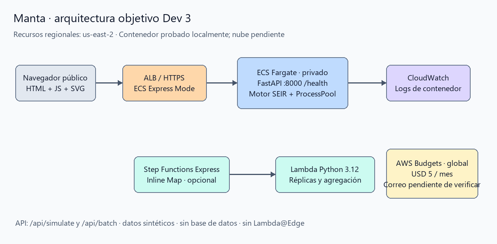

# Simulador de Contención Epidémica de Manta

Spookython · Track B. Compara un protocolo territorial de vacunación con
vacunación al azar y ausencia de intervención en una red sintética de siete
sectores de Manta. Python 3.12, FastAPI, Vanilla JavaScript y SVG; sin npm build.

**Simulación computacional ficticia con fines académicos para el Spookython
Hackathon. No constituye una predicción epidemiológica ni una recomendación
sanitaria real.**

Integra `dev1-manta-seir-engine` y `dev2-frontend-visualization`. Dev 3 (Josué)
añade API, contenedor, configuración cloud y entregables. Sustituye al prototipo
local anterior.

## Ejecución y pruebas

```powershell
python -m venv .venv
.venv\Scripts\Activate.ps1
python -m pip install -r requirements.txt
python -m pip install -e ".[test]"
python -m uvicorn seir.app:app --host 0.0.0.0 --port 8000
```

Abrir http://localhost:8000. Alternativa Conda: `conda create -n manta python=3.12`,
`conda activate manta` y ejecutar los comandos pip y Uvicorn.

```powershell
python -m pytest -q
node --test tests/frontend.test.cjs
docker build -f infra/Dockerfile -t manta-sim:dev3 .
docker run --rm --cpus=0.25 --memory=512m -p 8000:8000 manta-sim:dev3
```

`pyproject.toml` es la fuente de dependencias. El lock de producción
`requirements.txt` se regenera con Python 3.12:

```powershell
python -m pip install pip-tools
python -m piptools compile pyproject.toml --output-file requirements.txt --strip-extras --no-emit-index-url --no-emit-trusted-host
```

## Reproducción para el jurado

[Configuración oficial](configs/default_params.json): semilla **42**, N=1000,
T=60, β=0,03, σ=0,2, γ=0,1, grado=8, foco Tarqui=10, modo dinámico,
cuota estática de referencia=30, stock=400, eficacia=0,8, retraso=0,
voluntariado=0,12 y reinfección=0,04. Parámetros ilustrativos, sin calibración
con registros clínicos reales.

```powershell
$body = Get-Content configs/default_params.json -Raw
Invoke-RestMethod http://localhost:8000/health
Invoke-RestMethod http://localhost:8000/api/simulate -Method Post -ContentType application/json -Body $body | ConvertTo-Json -Depth 20
```

El protocolo prioriza puentes del sector activo, hubs internos y anillo de
contactos; reinvierte sobrantes en hubs preventivos. El azar usa las mismas dosis
por día. Si le faltan susceptibles, se limita previamente la cuota compartida
para mantener la comparación válida.

| Estrategia | Contagios acumulados | Contagios evitados | Dosis |
|---|---:|---:|---:|
| Propuesta | 33 | 274 | 400 |
| Azar | 146 | 161 | 400 |
| Sin intervención | 307 | 0 | 0 |

Resultados de la configuración anterior, contrastados en la
[verificación](docs/verificacion.md). Contagios evitados es la diferencia
emparejada frente a no intervenir; no se estiman muertes. Monte Carlo reporta
rango empírico p2.5–p97.5, no un intervalo de confianza de la media.

## API y decisiones

- `GET /health`: `{"status":"healthy"}`.
- `POST /api/simulate`: [contrato Anexo A](docs/superpowers/specs/2026-10-27-manta-containment-simulator-design.md).
- `POST /api/batch`: `{"base": <configuración>, "replicas": 30}`. Máximo 100;
  retorna media, p2.5, p97.5, mínimo y máximo, sin trazas por nodo.
- Límites N=7–2000, días=0–90, grado=0–50 y menor que N, stock ≤ 0,40 N,
  cuerpo ≤ 64 KiB. Entradas inválidas: HTTP 400.
- Máximo dos solicitudes de cálculo concurrentes; exceso: HTTP 429 y
  `Retry-After: 2`. ProcessPoolExecutor de dos procesos mantiene disponible
  el servidor de salud y estáticos. Ejecutar un solo worker Uvicorn.
- Sin animación: `frames: null`. Con animación: topología y diffs diarios;
  gzip mantiene la transferencia de la configuración oficial bajo 50 KB.
  El JSON descomprimido es mayor.
- R₀=β·grado/γ. Con γ=0 y β>0 se representa como `null`, evitando Infinity
  inválido en JSON; la interfaz indica «No calculable».

## Arquitectura y despliegue



[Fuente editable draw.io](docs/arquitectura.drawio). Recursos regionales en
**us-east-2**. ALB público HTTPS y tarea ECS Fargate de 256 CPU / 512 MiB,
puerto 8000, salud `/health`. El contenedor no necesita credenciales para
simular. Step Functions Express + Lambda son un complemento condicional;
`/api/batch` funciona localmente sin ellos.

**Estado: servicio ECS y URL pública de esta versión pendientes de despliegue
y verificación externa.** No se usa una URL del prototipo anterior como prueba
de esta versión. Seguir la [receta](infra/README.md), completar imagen y roles
en `infra/ecs_service.json`, y ejecutar:

```powershell
aws ecs create-express-gateway-service --region us-east-2 --cli-input-json file://infra/ecs_service.json
```

Guardar el ARN y comprobar HTTPS desde otra red. Después de evaluar:

```powershell
aws ecs delete-express-gateway-service --region us-east-2 --service-arn <ARN>
```

Revisar que no queden recursos asociados cobrando. No se utilizan App Runner,
CodeCommit, Cloud9, OpsWorks ni Lambda@Edge.

## Presupuesto y entrega


Presupuesto existente con tres notificaciones configuradas; **falta verificar
el correo destinatario** para recibirlas. La alerta no bloquea gasto.
[Cálculo y gasto comprobado](docs/costos.md): estimación de USD 1,20/día o
USD 36,39/mes antes de variables, bajo los supuestos documentados.

La [verificación](docs/verificacion.md) distingue pruebas locales de pendientes:
URL externa, validación cloud, correo y costo final. La presentación del pitch
exigida por la organización también debe incorporarse antes de entregar.

## Organización y limitaciones

`configs/`: parámetros; `docs/reto/`: cinco archivos oficiales;
`docs/superpowers/`: planes y especificaciones; `src/seir/`: motor, API y
`static/`; `infra/`: Docker, ECS y complemento Pro; `tests/`: motor, topología,
estrategias, brigadistas, frontend y API. Sin datasets del prototipo anterior.

Red sintética y parámetros ilustrativos, sin validación clínica ni pronóstico
sanitario. Las metas p95 se miden y dependen del hardware y CPU contratado;
no se deducen de que las pruebas pasen.
